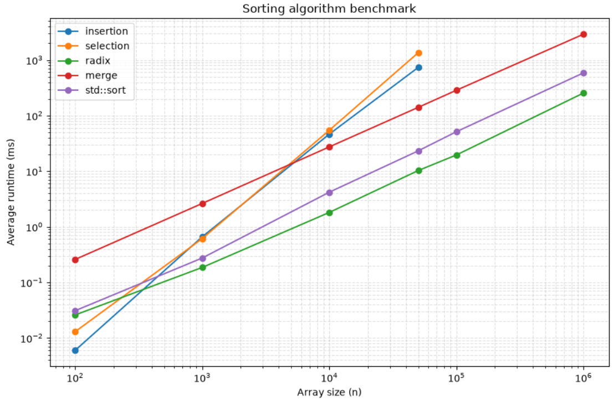

Test the performance (meaning how long it takes for the code to run) of your sorting algorithms on sorting different sized lists of numbers. Create some representation (e.g., a table or a plot) of the runtimes of the algorithms as a function of list size. In a writeup (I would suggest a markdown file), discuss how you tested your algorithms (e.g., how you generated the lists to be sorted, how many times you performed each experiment). Draw some conclusions based on your experiment (e.g., which algorithm seems faster and in which cases).

The test script runs all 4 algorithms against the built in sort method(quicksort). The numbers to sort are randomly generated from 0 to 1000000. Since radix sort does not work for negative numbers, no negative numbers can be generated. Algorithms are also run on different length lists from 100 numbers to 100000 numbers to get a sense of how they scale over time. Each algorithm was run on 5 different lists for each scale. It was then formatted as a table which was plotted using python. 

At size 100, merge sort was the slowest meanwhile the others had similar runtimes. However selection and insertion have O(n^2) scaling and take a long time to run when n increases. Merge sort and std::sort degrades more gracefully because of the O(nlog(n)) runtime. Radix sort was the fastest as it is O(kn) where k is the number of digits in the largest number. The numbers tested may not have had a k large enough to show it's inefficiencies. 

Table of Results

| size    | insertion | selection | radix  | merge   | std::sort |
|--------:|----------:|----------:|-------:|--------:|----------:|
| 100     | 0.009     | 0.014     | 0.026  | 0.257   | 0.019     |
| 1000    | 0.512     | 0.658     | 0.183  | 2.705   | 0.280     |
| 10000   | 45.397    | 54.982    | 1.812  | 29.136  | 4.578     |
| 50000   | 2097.103  | 3467.629  | 21.227 | 254.626 | 39.914    |
| 100000  | 9705.497  | 13873.668 | 39.078 | 508.465 | 85.649    |

Plot showing results:

