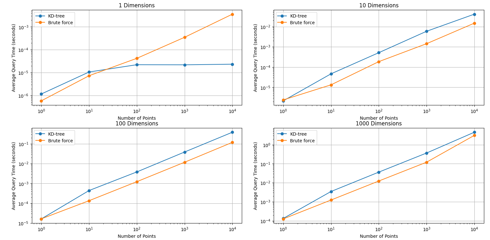
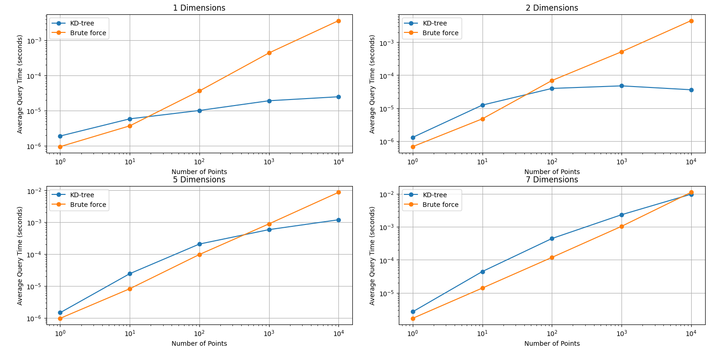

Figure 1: Varying the number of points from 1 - 10000 while also varying the number of dimensions per point from 1-1000. The runtime was measured and plotted for both the brute force algorithm and the KD trees algorithm.

Figure 2: Varying the number of points from 1 - 10000 while also varying the number of dimensions per point from 1-7. The runtime was measured and plotted for both the brute force algorithm and the KD trees algorithm.

Images 1 and 2 show various graphs where points are varies from 1 - 10000 points. Each graph has a different value or k or dimension of the points. The orange line is brute force while the blue line is KD Trees. 
As shown in the graphs, We can see that when k is small from 1 - 5 and the number of points is large it is much more efficient. However as k gets very large while the number of points remains comparitively smaller, it is less efficient then brute force. Brute force works better for small amounts of points where dimension is very large while KD trees work when dimension is comparitviely smaller than the number of points.

